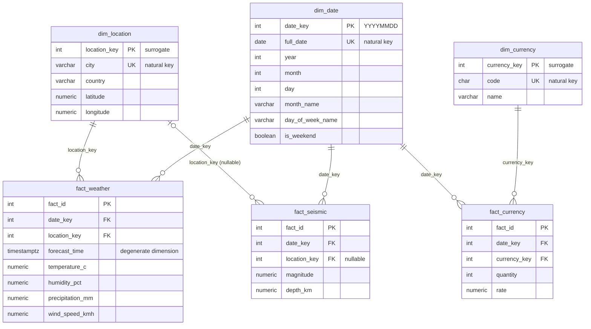

# ⭐ Star Schema — Enterprise Open Data Platform

> Kimball-ის dimensional model `analytics` schema-ში, რომელიც ამინდის, ვალუტისა და სეისმური მონაცემების დამოუკიდებელ domain-ებს ერთ ანალიტიკურ მოდელად აერთიანებს.

## 📌 მიმოხილვა

Operational schema-ები (`weather`, `currency`, `seismic`) ოპტიმიზებულია **ჩაწერისთვის** (3NF). `analytics` schema კი აგებულია **წაკითხვისა და ანალიზისთვის**:

- **Fact ცხრილები** ინახავს გაზომვებს (ტემპერატურა, კურსი, მაგნიტუდა);
- **Dimension ცხრილები** ინახავს კონტექსტს (როდის, სად, რომელი ვალუტა).

მთავარი იდეა: სამივე fact ცხრილი იზიარებს ერთ `dim_date`-ს. ეს არის **conformed dimension**, რის გამოც სხვადასხვა domain-ის მონაცემი ერთ query-ში მარტივად ერთიანდება.

## 🗺️ ER დიაგრამა

> **როგორ იკითხება:** `||--o{` ნიშნავს „ერთი dimension-ის მწკრივი → ნული ან მეტი fact-ის მწკრივი“. `|o--o{` (`dim_location` → `fact_seismic`) აღნიშნავს, რომ კავშირი **არასავალდებულოა**, რადგან `location_key` შეიძლება ცარიელი იყოს.

## 📐 Dimensions (conformed)

| ცხრილი | Surrogate Key | Natural Key | მწკრივების რაოდენობა | გამოიყენება |
|---|---|---|---|---|
| `dim_date` | `date_key` (INT, YYYYMMDD) | `full_date` | 61 (2026-08-01 – 2026-09-30) | სამივე fact ცხრილში |
| `dim_location` | `location_key` (SERIAL) | `city` | 5 | `fact_weather`, `fact_seismic` |
| `dim_currency` | `currency_key` (SERIAL) | `code` | 5 | `fact_currency` |

## 📊 Facts

| ცხრილი | Grain (რას წარმოადგენს 1 row) | დაკავშირებული dimension-ები | გაზომვები (measures) |
|---|---|---|---|
| `fact_weather` | 1 ქალაქის 1 საათის ამინდის საზომი | `dim_date`, `dim_location` | temperature_c, humidity_pct, precipitation_mm, wind_speed_kmh |
| `fact_currency` | 1 ვალუტის 1 დღის კურსი | `dim_date`, `dim_currency` | quantity, rate |
| `fact_seismic` | 1 სეისმური მოვლენა | `dim_date`, `dim_location` (nullable) | magnitude, depth_km |

## 🔄 Source → Target (ETL-lite)

| Operational წყარო | Fact ცხრილი | Dimension-ის მოძებნა |
|---|---|---|
| `weather.forecasts` | `fact_weather` | `city` → `location_key`; `forecast_time` → `date_key` |
| `currency.rates` | `fact_currency` | `currency_code` → `currency_key`; `rate_date` → `date_key` |
| `seismic.events` | `fact_seismic` | `place` (ტექსტური დამთხვევა) → `location_key`; `event_time` → `date_key` |

## 🧭 დიზაინის გადაწყვეტილებები

- **Smart surrogate key `date_key`.** INT ფორმატი `YYYYMMDD` (მაგ. `20260827`) Kimball-ის გავრცელებული პატერნია date dimension-ისთვის: key თავად იკითხება და ძალიან იაფად ერთიანდება.
- **Surrogate და natural key ცალ-ცალკე.** Surrogate key-ები (`SERIAL`) ცვლილებებისგან იცავს fact ცხრილებს, ხოლო natural key (`city`, `code`) `UNIQUE` constraint-ით რჩება მონაცემთა მთლიანობისთვის.
- **Degenerate dimension `forecast_time`.** საათობრივი დეტალი ცალკე dimension-ს არ საჭიროებს და პირდაპირ `fact_weather`-ში ინახება.
- **Nullable `location_key` `fact_seismic`-ში.** მიწისძვრის `place` ტექსტიდან ქალაქის მოძებნა ხდება `ILIKE`-ს ტექსტური დამთხვევით (`LEFT JOIN`), ამიტომ ზუსტი დამთხვევა ყოველთვის არ არის გარანტირებული და მოვლენა მაინც არ იკარგება.

## 💡 რატომ ეს დიზაინი

`dim_date` არის conformed dimension: სამივე fact ცხრილი მას იზიარებს, რაც cross-domain ანალიზს ტრივიალურად ხდის. ერთ query-ში შეიძლება ერთდროულად ვნახოთ, **რა ამინდი იყო**, **როგორი იყო USD-ის კურსი** და **რამდენი მიწისძვრა მოხდა** კონკრეტულ დღეს. იმავე რამეს 3NF operational ცხრილებზე გაცილებით რთული join-ები დასჭირდებოდა.

მაგალითი: [`009_cross_domain_analysis.sql`](../lectures/lecture-06-data-modeling/sql/009_cross_domain_analysis.sql)

## ⚠️ ცნობილი შეზღუდვები და შემდეგი ნაბიჯები

- `fact_seismic`-ის ლოკაციის მიბმა ტექსტზეა დაფუძნებული. კოორდინატებზე დაფუძნებული ზუსტი geo-join მოგვიანებით დაემატება.
- `dim_location` ამჟამად მხოლოდ მიმდინარე მდგომარეობას ინახავს. ისტორიის თვალყურის დევნებისთვის გათვალისწინებულია **SCD Type 2** (Lab 6, Step 8).
- Fact ცხრილების შევსება ამჟამად ერთჯერადი SQL სკრიპტითაა. ის მოგვიანებით ETL pipeline-ში გადავა.
